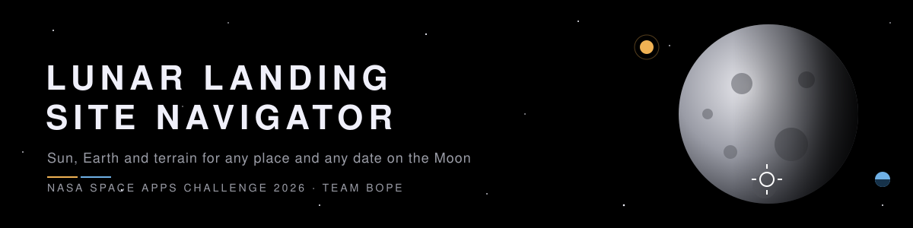
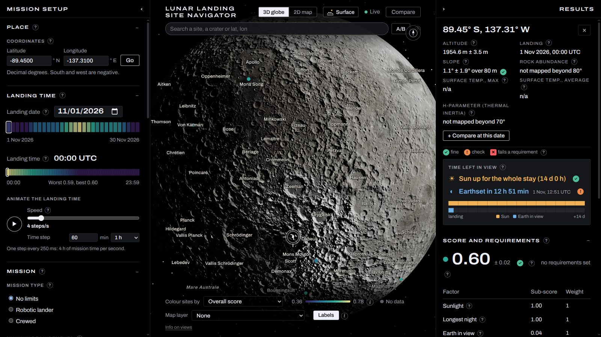
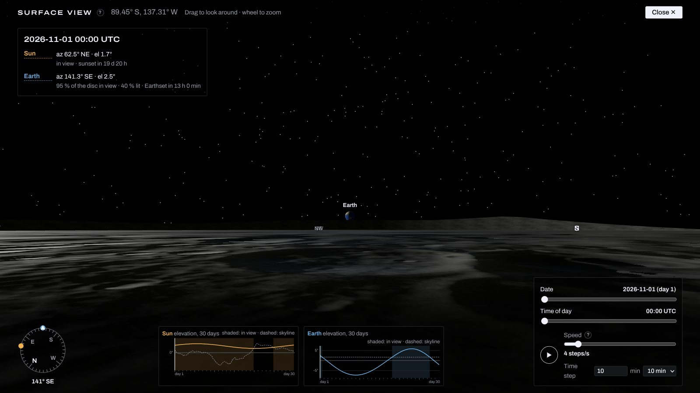
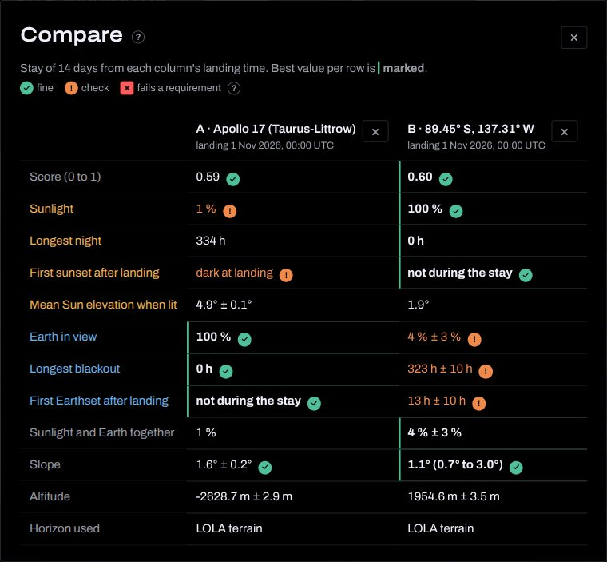
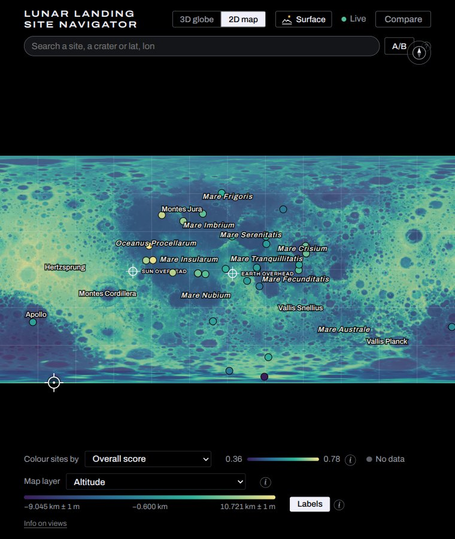
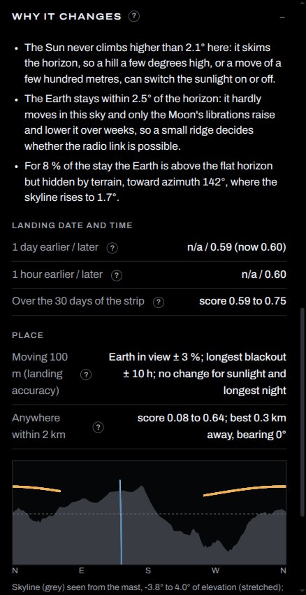
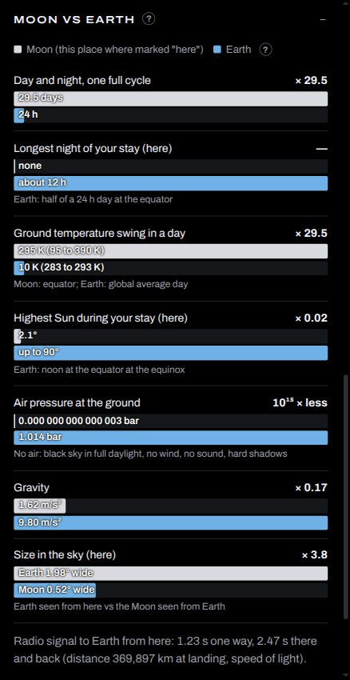
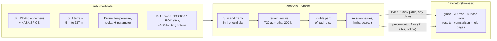

<p align="center">
  
</p>

<p align="center">
  
  
  
  
</p>

<p align="center"><b>Pick any place on the Moon and any landing date from 1850 to 2149.<br>
See where the Sun and the Earth are over the real terrain, how long the lander keeps power and a link home,<br>
and why a few hundred metres or a single day can change everything.</b></p>

<p align="center">
  
</p>

---

## The question it answers

> *The launch slipped. Which nearby site, or which other date, still works?*

At the lunar south pole the Sun never climbs more than a few degrees and the Earth hovers on the horizon. A ridge one degree high decides whether a lander has **power** (the Sun in view for its solar arrays) and **communication** (the Earth in view for a direct radio link). Planners must re-evaluate sites and dates quickly whenever a schedule moves; the tools that hold the data are built for specialists. The navigator puts the answer on one screen, for mission planners, educators and anyone curious about why landing on the Moon is hard.

## What you can do

<table>
<tr>
<td width="50%" valign="top">

**☀ ◐ Time left in view**<br>
Countdown to sunset and Earthset with the exact UTC time, and the whole stay drawn as two bars: when the Sun and the Earth are in view.

**✓ ! ✕ Warnings that mean something**<br>
Red only when a requirement you set is broken; orange when a value is *at risk* within the landing accuracy, or outside a published criterion (Artemis III slope 10°, Earth in view 25 %). Hover any badge for the reason.

**🔍 Search and A/B comparison**<br>
Find a known landing site, any of 2 023 IAU feature names, or typed coordinates. Pick A and B and compare them side by side, each at its own date.

</td>
<td width="50%" valign="top">

**🌄 Stand on the surface**<br>
A street-level view from the chosen place: the real skyline from LOLA, the Sun and the Earth moving over 30 days, rises and sets behind the terrain.

**🧭 Why it changes**<br>
What one day, one hour or 100 m does to the result, the score range within 2 km, and the reason in plain words, read from the Sun's path against the skyline.

**🌍 Moon vs Earth**<br>
A 29.5-day day, a 295 K temperature swing, 10¹⁵ × less air, the Earth 3.8 × wider in the sky than the Moon from Earth: the differences drawn to scale.

</td>
</tr>
</table>

<table>
<tr>
<td width="50%"></td>
<td width="50%"></td>
</tr>
<tr>
<td align="center"><sub>Surface view at 89.45° S: the Earth sits 2.5° above a real ridge</sub></td>
<td align="center"><sub>A/B: Apollo 17 is dark at landing; the pole point loses the Earth after 13 h</sub></td>
</tr>
<tr>
<td width="50%"></td>
<td width="50%"></td>
</tr>
<tr>
<td align="center"><sub>11 map layers with exact colour-bar ends and their accuracy (here: altitude ± 1 m)</sub></td>
<td align="center"><sub>Why it changes: reasons, sensitivity and the skyline panorama</sub></td>
</tr>
</table>

<p align="center"></p>

Also: 31 known landing sites with cited coordinates (Apollo, Luna, Chang'e, Chandrayaan-3, SLIM, CLPS, ispace), robotic and crewed (Artemis III) mission presets, a landing-date strip and a time-of-day strip coloured by the result, an animation of the landing time, nearby search, a whole-Moon score map, and a **"?" next to every value** that opens its documentation with formulas and references.

## How it works



- **The physics lives in one place.** The Python analysis does every calculation; the web page only displays its answers. Each number on screen traces back to one function and one dataset.
- **No air, so the terrain decides.** The skyline is traced over the LOLA altitude maps in 720 directions out to 200 km, using the finest map at each distance (5 m near the pole). A time step counts as *in view* when at least half of the Sun's or the Earth's disc clears the skyline.
- **Librations are in the ephemeris.** DE440 carries the Moon's real rotation, so the Earth's slow sway in the lunar sky comes out of the data, not a separate model.
- **Uncertainty is propagated, not guessed.** Every value is recomputed on a 100 m ring (the Artemis III landing accuracy) and with the skyline shifted by ± 0.1°.
- **One data contract.** JSON Schemas in [`contracts/`](contracts/) fix the shape of every file: units in field names, `{value, uncertainty}` for every displayed number, `null` instead of an invented value. The live API and the offline files follow the same contract, so the page works with either.

The full explanation, chapter by chapter, is in **[How it works (PDF)](docs/BOPE-navigator-how-it-works.pdf)**.

## Checked against NASA references

| Check | Result |
|---|---|
| Sun and Earth directions vs **JPL Horizons** (5 sites × 2 bodies × 12 instants) | largest difference **0.00069°** as served, distances within 0.18 km |
| Terrain skyline vs NASA's **LOLA long-term visibility maps** (150 points south of 85.5° S) | correlation **r = 0.982** (Sun), **r = 0.996** (Earth) |
| Our 80 m slope vs NASA's 80 m slope map | median difference 0.10° to 0.17°, r ≥ 0.996 |
| Repeat period of sunlight / Earth visibility | 29.5 d (synodic month 29.53 d), 27.2 d at the pole (draconic month 27.21 d) |
| Documentation | every page has a reference; every citation is tested automatically |

Item by item, with the open checks: [`docs/validation/navigator-audit.md`](docs/validation/navigator-audit.md).

## Download the Windows app

The whole navigator, analysis server included, as one Windows program: no Python, Node or terminal needed.

1. Download **`LunarNavigator.exe`** (about 230 MB) from the **[latest release](https://github.com/Gabri275/BOPE-lunar-navigator/releases/latest)**.
2. Double-click it. The program is not code-signed, so the first time Windows shows *"Windows protected your PC"*: click **More info → Run anyway**.
3. On the first start choose the **terrain maps**. The program opens on the navigator from then on; the choice can be changed at any time from the **Maps** menu.

| First-start choice | Download | What you get |
|---|---|---|
| **Use maps I already have** | none | Point to a folder that holds the maps (for example `data/raw` of this repository): the full analysis, at once |
| **Complete** | 13.7 GB | The full analysis: real terrain everywhere, 5 m terrain around the south pole, surface temperature, rock abundance, thermal inertia |
| **Base** | 3.1 GB | Real terrain skyline everywhere, slope and altitude, NASA's polar visibility and shadow maps. No temperature, rock or H-parameter values, no 5 m terrain |
| **Continue without maps** | none | Every place, every date and every view still work, with the horizon of a **smooth Moon**: no mountains or crater rims on the skyline, no slope or surface data. Near the poles the results are optimistic, because a ridge that would hide the Sun is not there |

What each choice computes:

| | No maps | Base | Complete |
|---|:-:|:-:|:-:|
| Sun and Earth for any place and date (JPL DE440), countdowns, surface view, comparison, score | ✓ | ✓ | ✓ |
| Real terrain skyline (LOLA): sunsets and Earthsets behind ridges | smooth Moon | ✓ | ✓ |
| Slope and altitude, the slope requirement | | ✓ | ✓ |
| 5 m terrain within 10 km near the south pole | | | ✓ |
| Surface temperature, rock abundance, H-parameter and their requirements | | | ✓ |

The map layers on the globe and the 2D map are inside the program, so they show with every choice. The offline mode with only the 31 known sites (precomputed, landings at 00:00 UTC) is kept as a fallback, used only if the built-in server cannot start.

- **Downloads** come straight from NASA's archives (PGDA, LOLA, PDS). They can be paused and resumed. Their speed is set by those servers: about 1 MB/s from the LOLA archive in our test, so Base can take about an hour and Complete several hours. After a download the program spends a few minutes, once, preparing the temperature and surface maps.
- **Files** live in `%LOCALAPPDATA%\BOPE Lunar Navigator`: `settings.json`, the downloaded `maps\` and `app.log`. To remove the program, delete the `.exe` and that folder.
- **Requirements**: Windows 10 or 11, 64-bit, with Microsoft Edge WebView2 (already part of Windows 10 and 11). Mac and Linux: run it from source, below.
- **Build it yourself**: `desktop/build.py` (instructions at the top of the file) makes the same `.exe` from this repository.

## Run it from source

**Front end** (Node 20+), offline data for the 31 known sites:

```bash
cd frontend
npm install
npm run dev            # http://localhost:5173
```

**Analysis server** (Python 3.11+) for any place, date and setting:

```bash
python -m venv .venv && .venv/bin/python -m pip install -r analysis/requirements.txt
.venv/bin/python -m analysis.download_kernels     # 45 MB of SPICE kernels from NASA NAIF
.venv/bin/python -m analysis.download_maps        # optional: the Base maps, 3.1 GB (real terrain, slope, altitude)
.venv/bin/python -m analysis.download_maps --all  # optional: the Complete maps, 13.7 GB (adds 5 m pole, temperature, rocks, H)
.venv/bin/python -m uvicorn analysis.api:app --port 8000
```

`download_maps --check` lists what is present; downloads resume where they stopped. Without maps the server uses a smooth-Moon horizon (see the table above).

Or, with [uv](https://docs.astral.sh/uv/), `npm run api` from `frontend/`. The page switches to **Live** as soon as the server answers; interactive API docs at `http://localhost:8000/docs`. On Windows use `.venv\Scripts\python.exe`.

Tests: `npm test` in `frontend/` (276 tests), `python -m pytest analysis` (83 with all maps).

## Repository

```
analysis/      physics: ephemeris, terrain skyline, visibility, metrics, scoring, uncertainty, API
contracts/     JSON Schemas and API reference shared by both sides
data/          SITES.md, MAPS.md; processed/ = precomputed files (raw maps are downloaded, not committed)
frontend/      React + TypeScript + three.js navigator; src/docs/topics.ts = the help pages
desktop/       the Windows app: app.py (window, local server, first-start maps page), build.py (makes the .exe)
docs/          PARAMETERS.md (every value and formula), DECISIONS.md, validation/, LOG.md, TASKS.md
```

| Read next | What it holds |
|---|---|
| [docs/BOPE-navigator-how-it-works.pdf](docs/BOPE-navigator-how-it-works.pdf) | concepts, data and methods in 14 pages |
| [docs/PARAMETERS.md](docs/PARAMETERS.md) | every parameter, its formula and its source |
| [contracts/API.md](contracts/API.md) | the live API, endpoints and speeds |
| [data/MAPS.md](data/MAPS.md) · [data/SITES.md](data/SITES.md) | the NASA maps used and the 31 sites with their sources |
| [docs/DECISIONS.md](docs/DECISIONS.md) | what we chose, why, and what we rejected |
| [docs/CHALLENGE.md](docs/CHALLENGE.md) | the challenge text and our reading of it |

## Honest limits

- **Earth in view is geometry, not a link:** Deep Space Network station availability and link budgets are not modelled.
- **Maps cannot see boulders:** slopes are measured over 80 m or more; rock abundance counts rocks larger than about 1 m.
- **The score and the default warning bands are tools, not standards;** where a value is our own choice the documentation says so.
- **Offline mode is limited** to the 31 known sites, landings at 00:00 UTC from November 2026 to April 2027 and default settings. Everything else needs the analysis server and its maps.

## Team BOPE

| | Role |
|---|---|
| **Erdeniz Esmeli** | front end and integration (computer engineering) |
| **Gabriele Pisciotta** | analysis and physics model (aerospace engineering) |

## Credits

NASA/JPL (DE440, Horizons), NASA NAIF (SPICE), NASA GSFC PGDA and the LOLA team (altitude, slope, visibility and shadow maps), the Diviner team (temperature, rock abundance, H-parameter), NASA NSSDCA and LROC (site coordinates, imagery), NASA Scientific Visualization Studio (CGI Moon Kit), IAU / USGS Gazetteer of Planetary Nomenclature, Solar System Scope (Sun and Earth textures, CC BY 4.0), Wikipedia (mission summaries, CC BY-SA 4.0). Full references in the PDF and in every help page.

*AI use:* code and documentation were written with the help of an AI coding assistant (Claude Code). Physics, data and results were checked against the NASA references above.
